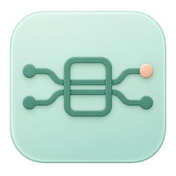
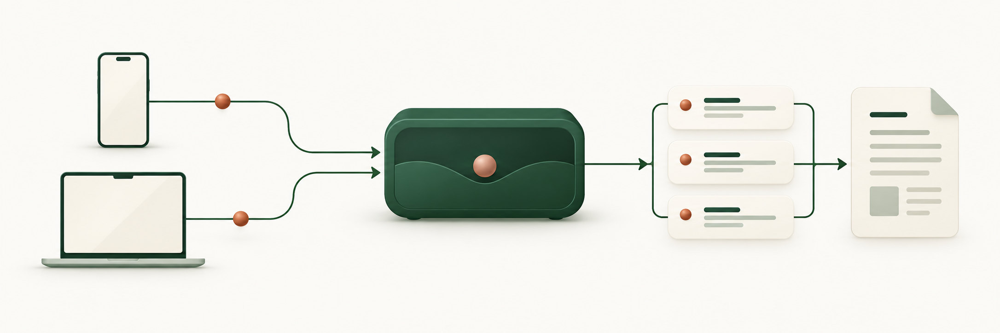
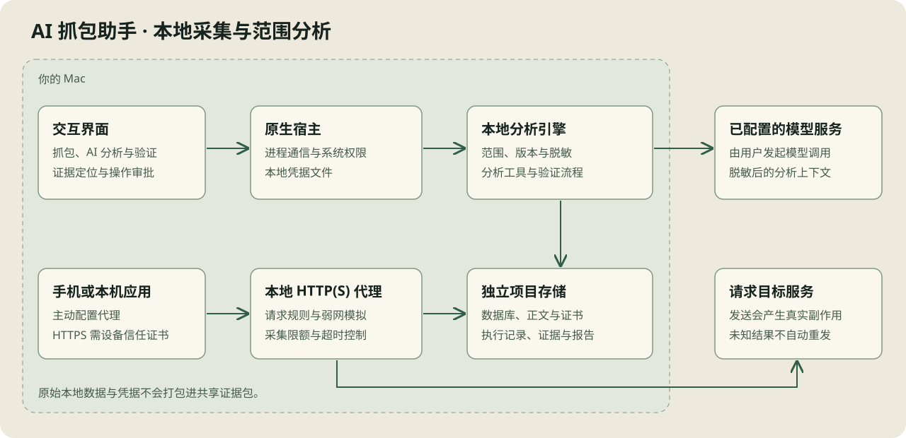

# AI 抓包助手

**在一台 Mac 上，把接口问题从抓包追到可复核的证据。**

本地 HTTP(S) 抓包、AI 调查与 QA 复现工作台。逐条查看请求，用固定范围的 Agent 查字段和关联，再把结论、重放与验证步骤交接给同事。



[安装与首次使用](docs/install.md) · [使用指南](docs/user-guide.md) · [完整功能](docs/features.md) · [贡献指南](CONTRIBUTING.md)

> **0.2.1 开发预览。** 本地抓包和离线数据查看无需部署服务端，也不需要模型账户；AI 分析使用你配置的供应商。原问题待办、真实 Provider、手机和完整桌面验收尚未关闭。[逐项进度](docs/completion-tracker.md)。当前本机构建为 ad-hoc 签名、未公证，不能视为下载即用的正式发行。

## 可以用它做什么

| 场景 | 能力 |
| --- | --- |
| 排查接口 | Host/逐条请求列表、时序、组合筛选、分页与虚拟列表，按需读取正文和 JSON Pointer |
| 让 AI 查证 | 固定样本与版本，调用检索/聚合/字段/Diff/Trace 工具，结论附证据与未检查范围 |
| 调试与复现 | Map Local/Remote、Rewrite、弱网，变更预览与恢复；编辑重放、变量步骤、故障矩阵 |
| 回归与交接 | 成功基线、业务键配对、可编辑人工清单，Markdown/JSON 报告与脱敏证据包 |
| 交换数据 | HAR 导入/导出、OpenAPI/Swagger JSON 子集校验、OTLP JSON Span 导入 |
| 分离项目 | 独立数据库、正文、规则、环境、场景与模型历史；API Key 保存在本机独立凭据文件，重启复用，无需钥匙串授权 |

Agent 默认只读；调试模式的写操作需要预览和审批。开启自动执行可跳过原有规则/弱网等工具的后续审批；新增Shell、代理管理、设备授权和批量发送仍逐次人工批准，请在理解具体变更后使用。平台集成仍有边界：现有有限 HTTP MCP/Trace GET/Webhook 入口不等于标准 MCP 客户端或已完成的真实平台适配。

## 下载与安装

[版本下载入口](https://github.com/STEVE-DENG/ai-proxy/releases) · [安装说明](docs/install.md) · [0.2.1变更](docs/release-notes-0.2.1.md)

本次预发行提供 **Apple 芯片 Mac（M 系列）** 的 DMG 和 ZIP。打开 DMG，将 `AI Proxy.app` 拖入「应用程序」即可安装，Python 引擎随应用提供。Intel 版尚未发布；当前预览包未经过 Apple 公证，首次打开可能需要在系统设置中核准。

[下载 0.2.1 中文预览版](https://github.com/STEVE-DENG/ai-proxy/releases/tag/v0.2.1) · [查看安装方法](docs/install.md)

## 从采集到交接

1. **先看清请求。** 同一Wi-Fi连接手机、抓本机，或直接导入合成HAR；默认每个请求一行，需要目录时可展开Path。
2. **让结论带上来源。** 选择筛选、手选或场景范围，Agent查询字段和关系；证据附请求、版本和位置，范围变化时先确认恢复。
3. **复现并留下检查步骤。** 编辑Compose/Repeat预览，审批后发送；比较成功基线，记录通过/失败/待查，再导出报告。



模型只会收到本次操作组织的上下文；抓包和导入数据仍需你检查脱敏。外部写入会产生真实副作用，未知结果不自动重发。详见[架构](docs/architecture.md)和[安全边界](SECURITY.md)。

## 从源码运行

需要 macOS、Xcode Command Line Tools、Node.js 22+、Rust stable 和 `uv`。引擎固定使用 Python 3.12，`uv` 可管理该解释器。当前只核查过 Apple Silicon 本机产物；Intel Mac 尚待验证，Windows/Linux 暂不支持桌面功能。

```bash
git clone https://github.com/STEVE-DENG/ai-proxy.git
cd ai-proxy
npm ci
npm run engine:sync
```

Tauri 的构建配置声明了 sidecar。全新 checkout 先冻结一次引擎以满足构建期文件检查：

```bash
npm run engine:freeze
npm run tauri dev
```

开发模式运行 `engine/.venv/bin/python`，优先使用当前 Python 源码。单独 `npm run dev` 只有界面开发服务器，无法提供完整桌面 IPC 能力。详细环境、命令和排障见 [开发指南](docs/development.md)。

## 第一次使用

首次打开可从「帮助」选择手机、本机或离线导入；「工作台 → 导入与互操作 → 体验合成示例」可直接导入，也可手动导入 [合成 HAR / OpenAPI / OTLP 示例](examples/README.md)，无需开启代理或调用模型。

1. 进入「抓包」，开始采集；在设置的代理入口启用本机系统代理。HTTPS 还需安装并信任应用生成的 CA。
2. 发起自己可控制的请求，在 Host/请求列表中查看详情、筛选或对比。手机可从「连接手机」配置同一 Wi-Fi 下的代理和 CA。
3. 在设置中配置模型供应商，选择当前筛选、多选请求或场景发起只读分析；点击证据返回原请求。
4. 从工作台进入重放、基线回归、故障矩阵、人工验证和证据交接。重放会真实发送请求，请先核对预览。
5. 结束后停止采集，关闭手机 Wi-Fi 代理，并核对 Mac 系统代理已恢复。

新项目默认先抓 HTTP，HTTPS 解密需主动开启；已有项目保留原解密配置。可以按 Host 开启，或明确选择全部域名。仅在你有权调试的设备与环境中使用。模型请求会发送脱敏后的上下文到所配置供应商，脱敏规则不能保证清除自由文本中的所有隐私。[数据与安全边界](SECURITY.md)。

## 运行诊断与效率

设置中的存储健康检查可核对磁盘、目录和数据库可读性；抓包页设置可分别保存请求总时限和流空闲时限。主窗口和弹窗底部显示任务等待与回执未知；执行记录可只读比较已有Run的缓存、Token与耗时。详细步骤与HTTP/2边界见[使用指南](docs/user-guide.md)。

历史[RF01–RF56源码对照](docs/problem-fixes-status.md)记录全部清单入口与人工验收边界。可按原问题和条件重建快照，使用本地命令与完整输入估算；QA支持空白Compose、直连/本代理、有限次数/并发/间隔和总时限。发送前确认固定整组预览，未知结果不自动重试。

## 本地打包

```bash
npm run engine:freeze
npm run app:build
```

输出：`src-tauri/target/release/bundle/macos/AI Proxy.app`。sidecar 为当前 Mac 架构，应用不需要目标机器另装 Python。分发签名、公证和验收要求见 [发布说明](docs/releasing.md)。构建目录和本地抓包数据不提交到 Git。

## 文档导航

| 文档 | 内容 |
| --- | --- |
| [安装与首次使用](docs/install.md) | 下载、初始化、手机/本机/离线路径与外观 |
| [本轮未完成项跟踪](docs/completion-tracker.md) | 原TODO逐条入口、本轮变更和仍未完成的事项 |
| [使用指南](docs/user-guide.md) | CA、手机接入、分析、调试、QA 与数据交换 |
| [完整功能与边界](docs/features.md) | 功能细节、数据限额、协议与契约支持范围 |
| [架构说明](docs/architecture.md) | React → Tauri → Python、持久化、Scope 和审批 |
| [开发指南](docs/development.md) | 环境、锁文件、检查、CI 和源码导航 |
| [故障排查](docs/troubleshooting.md) | 引擎、证书、代理恢复、缺失正文与过期证据 |
| [人工验收](docs/validation.md) | 已执行检查、未验收场景和可复制记录模板 |
| [实施状态与路线图](docs/roadmap.md) | 第二轮49项状态与下一步；附第一轮119项映射 |
| [问题修复RF01–RF56](docs/problem-fixes-status.md) | 原问题恢复、上下文/命令、Compose与高级重复、外层连接证据及完整历史 |
| [历史清单总复核与新增8条](docs/checklist-audit.md) | 第一轮119、第二轮49、UX60逐项落点及FIX01–08，区分源码与实机验收 |
| [体验改进与凭据升级](docs/ux-status.md) | UX01–60落点、一次重新录入、连接诊断与手动验收 |
| [变更记录](CHANGELOG.md) | 已提交开发变化与发布边界 |

## 参与贡献

欢迎提交可复现的问题、文档修正和范围明确的 Pull Request。先阅读 [贡献指南](CONTRIBUTING.md)；普通问题使用 [GitHub Issues](https://github.com/STEVE-DENG/ai-proxy/issues)。涉及凭据、CA 私钥或原始抓包的安全问题，请使用 [安全报告流程](SECURITY.md)。

本项目当前使用构建检查、隔离数据核查和人工验收，不维护自动化测试套件。CI 不调用真实供应商、不启动系统代理，绿色检查不代表真实环境验收通过。

## 许可证

项目原创代码使用 [MIT License](LICENSE)。第三方依赖、字体和工具保留各自许可证；打包分发时也需遵守其条款。新增 Markdown 组件的声明见 [第三方说明](THIRD_PARTY_NOTICES.md)。
