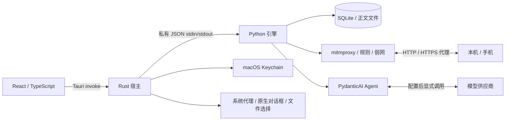

# 架构说明

[返回 README](../README.md) · [开发指南](development.md) · [安全边界](../SECURITY.md)

## 进程与数据流



前端通过 `src/lib/api.ts` 的 `call(method, params)` 调用 Rust `engine_call`。Rust 管理子进程、请求 ID 和事件转发，Python 以逐行 JSON 回复。stdout 只用于协议；日志写 stderr。代理/证书局域网端口不暴露这些控制方法。

## 源码职责

| 路径 | 职责 |
| --- | --- |
| `src/App.tsx`、`src/types.ts` | 页面状态、Run/项目/批次选择、事件协调与共享类型 |
| `src/components/CaptureWorkspace.tsx` | 抓包树、节点分页/实例窗口、虚拟化、详情与证据定位 |
| `src/components/AIWorkspace.tsx` | 会话、Run 历史、工具轨迹、预算、报告与审批 |
| `src/components/WorkbenchDialog.tsx`、`QAWorkspace.tsx` | 配置和 QA 工作流；`InspectionDialogs.tsx` 提供检查入口 |
| `src-tauri/src/lib.rs` | sidecar 生命周期、IPC、Keychain、系统代理、文件与原生确认 |
| `engine/ai_proxy_engine/app.py` | RPC 分发、项目切换、生命周期、导入和报告协调 |
| `storage.py` | schema、迁移、SQL 查询、索引、正文与各类持久记录 |
| `store.py` | 保留 Store/ID/时间工具的兼容导入入口 |
| `domain.py` | 固定范围、版本校验、字段/聚合/关系、契约、Trace、调试动作 |
| `agent.py` | PydanticAI 模型适配、工具循环、checkpoint、预算、审批与事件 |
| `privacy.py` | 统一确定性脱敏 |
| `replay.py`、`qa.py` | 固定预览重放、步骤/基线/矩阵/清单/证据包 |
| `proxy.py`、`rules.py`、`throttle.py` | 代理 hooks、采集队列、规则、TLS、流式记录和带宽预算 |
| `jobs.py` | 后台只读作业取消上下文，配合 SQLite progress handler |

## Scope 和证据

发起 Run 时固定批次、筛选、设备、时间范围和请求 ID/版本，并绑定配置版本/Hash 与签名。工具在应用侧复核全部范围，不能依靠模型自行遵守。范围为空、跨批次或引用失效时明确拒绝。

Scope 不是无限历史数据副本；请求完成或配置变化后，旧正文版本可能不可读。此时显示来源失效，用户以新范围重新调查。每条证据保留请求、方向、locator 与来源版本，比较证据可关联双方；界面按 locator 找页和字段，未找到不显示虚假的定位成功。

## Agent 状态与写操作

模型通过 SDK 工具循环查询数据，工具和事件持久化。消息 checkpoint 尽量保留中断前已完成的观察；重新启动会将未完成 Run 标为中断，继续分析会利用历史，而不是对写操作做自动断点重放。

工具明确区分成功、错误、拒绝、超时和取消。预算覆盖模型请求、工具次数/耗时、审批等待、总时限和 Token；达到限制时保留部分结果与未检查范围。

写能力只在调试模式注册。动作经过预览、所有者/版本/文件授权复核和审批；应用/恢复冲突不修改当前 runtime。重放先领取持久动作状态再发送，结果未知时不自动重试。内部幂等键不保证外部服务实现幂等。

## 数据布局与备份

默认根目录：`~/Library/Application Support/com.nekoya.ai-proxy/`。引擎命令行可用 `AI_PROXY_APP_DATA` 指向临时目录；桌面宿主会指定自己的 app data 目录，不把它当作 UI 支持的任意数据目录设置。

```text
com.nekoya.ai-proxy/
  projects.json
  ai-proxy.sqlite3           # 默认项目
  bodies/
  certificates/             # 包含 CA 私钥，禁止分享
  generated-mocks/
  migration-*.sqlite3        # 升级前备份，可能含敏感数据
  projects/<project-id>/
    ai-proxy.sqlite3
    bodies/
    certificates/
    generated-mocks/
```

数据库使用 WAL，当前 schema 为5，记录逐版本迁移。升级前用 SQLite backup 保留旧库，失败恢复；未来 schema 拒绝降级。正文独立落盘，SQLite 保存路径和状态。Provider 配置属于项目数据，Keychain 凭据通过宿主在调用时取出，不写入业务抓包库。

前端还在 WebView localStorage/sessionStorage 保存批次滚动、选择、筛选、草稿和当前 Run。只备份引擎目录不包含所有 WebView 状态或 Keychain。项目间隔离用于管理工作数据，不是同一 macOS 用户下的安全沙箱。

备份前正常退出应用，确认引擎结束和系统代理恢复，再复制整个数据根目录。不要只复制正在写入的主 `.sqlite3` 并遗漏 WAL/正文。需要恢复时先保留当前副本，再在应用关闭状态恢复完整目录；Keychain 和设备 CA 信任需分别处理。迁移备份只有数据库，不是完整正文/证书备份。

“清分析数据”删除当前项目抓包、会话、报告、导入、动作及 QA 结果，保留规则、环境等项目配置与供应商；“清项目”进一步清项目配置/规则/MCP设置。两者均保留供应商/Keychain，且不抹除迁移备份或已导出的文件。清批次后保留的报告仍可读，但其抓包来源会失效。

## 规模与真实性

查询通过 SQL 计数/树索引和每层分页减小传输，界面只渲染可见树节点与列表窗口；正文按需读取。聚合、关系、导入和流记录都有限额，必须展示覆盖与丢失，不能默认为完整数据。

启发式时间邻近、设备关联和 Trace/Span 候选并不证明因果；Span parent 与 Links 独立保留。详见 [功能边界](features.md) 与 [当前验收证据](validation.md)。
