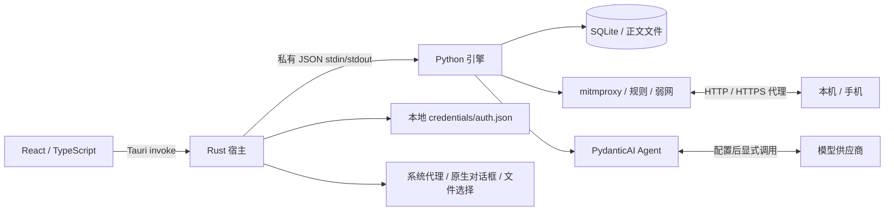

# 架构说明

最新行为：快照缺失选择恢复、未保存上下文保护、密钥读取期限、Compose版本/保存状态/等待边界、睡眠证据失效及后端历史分页，见[RI01–RI18交付](improvement-status.md)。旧构建/调查记录仍按其当时状态保留。

[返回 README](../README.md) · [开发指南](development.md) · [安全边界](../SECURITY.md)

## 进程与数据流



前端通过 `src/lib/api.ts` 的 `call(method, params)` 调用 Rust `engine_call`。Rust 管理子进程、请求 ID 和事件转发，Python 以逐行 JSON 回复。stdout 只用于协议；日志写 stderr。代理/证书局域网端口不暴露这些控制方法。

## 源码职责

| 路径 | 职责 |
| --- | --- |
| `src/App.tsx`、`src/types.ts` | 页面状态、Run/项目/批次选择、事件协调与共享类型 |
| `src/components/CaptureWorkspace.tsx` | 抓包树、节点分页/实例窗口、虚拟化、详情与证据定位 |
| `src/components/AIWorkspace.tsx` | 会话、Run 历史、工具轨迹、预算、报告与审批 |
| `src/components/WorkbenchDialog.tsx`、`QAWorkspace.tsx` | 配置和 QA 工作流；`InspectionDialogs.tsx` 提供检查入口 |
| `src-tauri/src/lib.rs` | sidecar 生命周期、IPC、本地凭据、系统代理、文件与原生确认 |
| `engine/ai_proxy_engine/app.py` | RPC 分发、项目切换、生命周期、导入和报告协调 |
| `storage.py` | schema、迁移、SQL 查询、索引、正文与各类持久记录 |
| `store.py` | 保留 Store/ID/时间工具的兼容导入入口 |
| `domain.py` | 固定范围、版本校验、字段/聚合/关系、契约、Trace、调试动作 |
| `agent.py` | PydanticAI 模型适配、工具循环、checkpoint、预算、审批与事件 |
| `privacy.py` | 统一确定性脱敏 |
| `replay.py`、`qa.py` | 固定预览重放、步骤/基线/矩阵/清单/证据包 |
| `proxy.py`、`rules.py`、`throttle.py` | 代理 hooks、采集队列、规则、TLS、流式记录和带宽预算 |
| `jobs.py` | 后台只读作业取消上下文，配合 SQLite progress handler |

## Scope 和证据

发起 Run 时固定批次、筛选、设备、时间范围和请求 ID/版本，并绑定配置版本/Hash 与签名。工具在应用侧复核全部范围，不能依靠模型自行遵守。范围为空、跨批次或引用失效时明确拒绝。

Scope 不是无限历史数据副本；请求完成或配置变化后，旧正文版本可能不可读。此时显示来源失效，用户以新范围重新调查。每条证据保留请求、方向、locator 与来源版本，比较证据可关联双方；界面按 locator 找页和字段，未找到不显示虚假的定位成功。

## Agent 状态与写操作

模型通过 SDK 工具循环查询数据，工具和事件持久化。消息 checkpoint 尽量保留中断前已完成的观察；重新启动会将未完成 Run 标为中断，继续分析会利用历史，而不是对写操作做自动断点重放。

工具明确区分成功、错误、拒绝、超时和取消。预算覆盖模型请求、工具次数/耗时、审批等待、总时限和 Token；达到限制时保留部分结果与未检查范围。

写能力只在调试模式注册。动作经过预览、所有者/版本/文件授权复核和审批；应用/恢复冲突不修改当前 runtime。重放先领取持久动作状态再发送，结果未知时不自动重试。内部幂等键不保证外部服务实现幂等。

## 数据布局与备份

默认根目录：`~/Library/Application Support/com.nekoya.ai-proxy/`。引擎命令行可用 `AI_PROXY_APP_DATA` 指向临时目录；桌面宿主会指定自己的 app data 目录，不把它当作 UI 支持的任意数据目录设置。

```text
com.nekoya.ai-proxy/
  credentials/auth.json     # 明文 API Key，目录0700/文件0600，禁止分享
  projects.json
  ai-proxy.sqlite3           # 默认项目
  bodies/
  certificates/             # 包含 CA 私钥，禁止分享
  generated-mocks/
  migration-*.sqlite3        # 升级前备份，可能含敏感数据
  projects/<project-id>/
    ai-proxy.sqlite3
    bodies/
    certificates/
    generated-mocks/
```

数据库使用 WAL，当前 schema 为6，记录逐版本迁移。升级前用 SQLite backup 保留旧库，失败恢复；未来 schema 拒绝降级。正文独立落盘，SQLite 保存路径和状态。Provider 配置属于项目数据，本地凭据文件由宿主在调用时按 Provider ID 读取，不写入业务抓包库。

前端还在 WebView localStorage/sessionStorage 保存批次滚动、选择、筛选、草稿和当前 Run。完整数据根备份包含凭据文件和 CA 私钥，需要保护；不包含全部 WebView 状态与系统/设备 CA 信任。项目间隔离用于管理工作数据，不是同一 macOS 用户下的安全沙箱。

备份前正常退出应用，确认引擎结束和系统代理恢复，再复制整个数据根目录。不要只复制正在写入的主 `.sqlite3` 并遗漏 WAL/正文。需要恢复时先保留当前副本，再在应用关闭状态恢复完整目录；设备 CA 信任需分别处理。SQLite 迁移备份只有数据库，不包含本地凭据、正文或证书。

“清分析数据”删除当前项目抓包、会话、报告、导入、动作及 QA 结果，保留规则、环境等项目配置与供应商；“清项目”进一步清项目配置/规则/MCP设置。两者均保留供应商/本地凭据，且不抹除迁移备份或已导出的文件。清批次后保留的报告仍可读，但其抓包来源会失效。

## 规模与真实性

查询通过 SQL 计数/树索引和每层分页减小传输，界面只渲染可见树节点与列表窗口；正文按需读取。聚合、关系、导入和流记录都有限额，必须展示覆盖与丢失，不能默认为完整数据。

启发式时间邻近、设备关联和 Trace/Span 候选并不证明因果；Span parent 与 Links 独立保留。详见 [功能边界](features.md) 与 [当前验收证据](validation.md)。


## 凭据、连接证据与缓存

`src-tauri/src/credentials.rs` 独立管理明文凭据；目录0700、文件0600，以受限临时文件写入/fsync/rename原子替换，拒绝符号链接读取及超过1MiB/损坏文件。不提供同账户进程隔离。宿主先保存凭据再保存去Key的配置，明确失败时补偿；超时可能已提交，保留凭据并提示核对，不以超时认定未执行。保存/读取/删除通过同一互斥锁协调；不自动访问旧Keychain。

`connections.py` 管理最多64个地址记录、项目级记住许可、活动writer和10分钟配对证据。外层监听先检查IP许可，再转发内部loopback mitmproxy；引导页单独可达。受控 `ai-proxy.test` 挑战由本地hook回答，HTTP/HTTPS证据按标识/来源/时间关联；不访问用户任意探测URL。网络变化/停止清活动连接与配对，前端检测长时间间隔后要求重新验证。诊断流不写业务抓包。监听地址不等于手机或目标App成功。

Provider缓存设置保存在 `provider-cache:<id>`，本身不引入schema变化（当前总体schema为6）。消息历史保留稳定前缀，预算超限时移出完整旧轮次并留摘要。工具缓存为进程内LRU，key含数据目录/Run/完整Scope/捕获generation/配置Hash/脱敏salt/函数参数，命中前后复核版本；128项/8MiB序列化预算/120秒TTL，非Python堆内存限额。模型请求逐次记录用量与延迟，汇总缓存零值保守显示未知。

Agent发送/续查带operationId，同一会话重试读取已存Run回执；清会话/项目会清映射。该机制防止回执丢失后的常规重复创建，不是外部业务幂等或进程崩溃下的跨表事务保证。

## 上下文与本机工具扩展

`agent.context`提供历史UTF-8字节估算/下轮保留量，`agent.context.set`保存项目预算，`agent.compress`写入以sourceRunId绑定的会话上下文覆盖记录，旧run_messages不改写；新Run保存checkpoint后覆盖记录自然失效，删会话/清分析同步删除。Scope只包含完成/终止请求，手选进行中明确拒绝；筛选/场景记录排除覆盖。引用摘要读取前后复核范围与版本，不能通过refs绕过快照。

Agent新增调试工具仍由PydanticAI审批机制执行，Shell/代理/手机准备/IP许可/批量重放不受autoApply跳过。Compose复用固定重放预览、所有权/版本校验与单次claim；Shell在独立进程组执行，限制时长和输出，取消清理该组。手机工具通过现有host-action事件打开UI，系统代理仍由Rust恢复快照。已存Key的主动查看是专用宿主命令，未接入Engine/Agent。

## RF清单补齐的数据流

`errors.py`将错误code经RPC和Rust传给React；恢复预览追溯原问题/引用并固定原条件。上下文面板调用本地估算，复用工具Schema而不创建模型客户端；预算和模型窗口分开保存。`agent.history`按会话分页，任务摘要来自原始user消息；选历史Run与异步刷新按代次隔离。

`composer.py`管理空白/来源Compose及有界Repeat。固定动作预览保存在replay_actions，任务状态保存在settings的replay-job键；启动校验、claim后异步发送，取消关闭客户端，启动恢复只标中断、不重发。代理通过一次性私有标识关联动作，转发前移除标识，由真实代理保存单一请求行。任务先于代理停机drain；执行审批与宿主回执旁路长任务锁。具体限制见[RF状态](problem-fixes-status.md)。

### 二次复核存储变更

schema6新增compose_jobs及createdAt/status索引；仅迁移一次旧replay-job设置，保留动作记录。preview_revision由请求/场景/配置/Provider/历史及相关设置的SQLite触发器更新，为完整输入预览提供保守来源指纹。Compose状态和历史通过最多2个后台读取工作执行，不占据业务事件循环的同步读库时间。报告历史每页摘要，正文通过reports.get按需读取。兼容reports.list保留；QA目录只读报告标题。


## 0.2.0界面与构建边界


外观偏好仅存主题/字号/密度，不存模型凭据。Select保留原生change语义，浮层独立定位，焦点停留在弹窗内触发器。工作台首次加载后保持挂载。启动状态事件只含阶段，不含文件正文；非必要历史/原生代理状态不阻塞首屏。

历史单轮过大时对模型输入副本生成固定节选，原Run协议记录不覆盖；不调用模型或重试写操作。版本/源码/图标/配置/锁文件与产物指纹写入构建记录，用于拒绝旧包分发与替换。构建/来源一致只证明产物关联，不代表运行验收。
